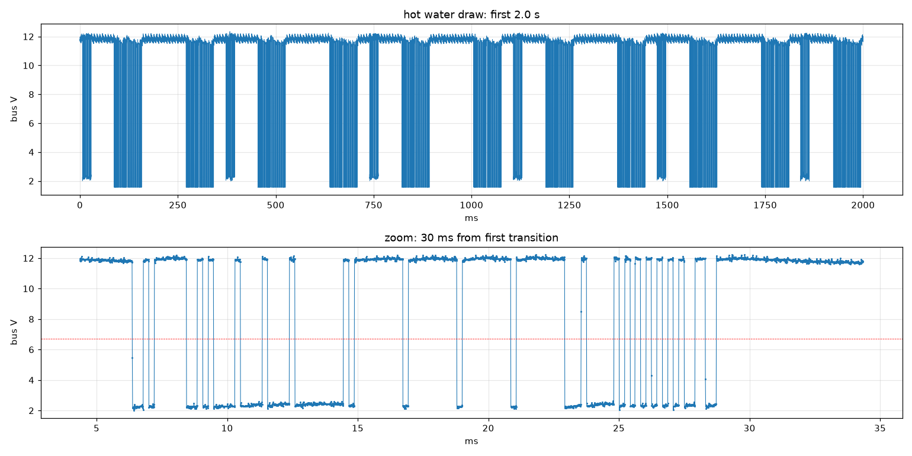

# esphome-therm-bus

ESPHome gateway for **Bosch Therm** gas water heaters that use a **2-wire wired remote**.
An ESP32 listens to the bus between the heater and its remote and publishes
everything to Home Assistant: temperatures, flow, burner power, flame, litres,
and an estimate of gas consumption that has been checked against a real gas meter.

> **Status:** read-only gateway working since October 2026 on a Bosch Therm 5600 O
> (T5600 O 15 V23). Control (on/off, setpoint) is planned: the commands are already
> decoded in [PROTOCOL.md](PROTOCOL.md), the transmit circuit is not built yet.
> Other models of the same family probably work: see [Compatibility](#compatibility).

This is **not** the EMS bus used by Bosch/Buderus/Junkers boilers (for that, see
[EMS-ESP32](https://github.com/emsesp/EMS-ESP32)). This bus runs at 4800 baud with
`F5`/`FA` frames and an additive checksum.

## Compatibility

Only one heater has been tested so far. Everything else in this table comes from
Bosch's own manuals, not from hardware. If you try another model, please open an
issue with the model code from the nameplate and a few values of the "Heater frame"
entity.

| Model | Status | Why |
|---|---|---|
| Therm 5600 O 15 V23 | **Tested** | the heater this was built on |
| Therm 5600 O 12 / 15 / 17, V23 (natural gas) and V31 (LPG) | Expected to work | same manual (6720888277) and same wired remote, which ships with the heater; only burner size and gas type differ. Set the gas factor for your size, see [Gas estimate](#gas-estimate) |
| Therm 5600 S 12 / 15 / 17 (indoor) | Likely, untested | same wiring diagram as the 5600 O, and its manual (6720888186) lists a remote control as an optional accessory. Without that remote there is no cable to tap: the control panel is on the front of the heater |
| Therm 5700 S, Junkers Hydronext 5600 S / 5700 S (WTD 12/15/17-3 AME, -4 AME) | Unknown | one Bosch service manual covers them together with the 5600 S; remote support not checked |
| Vulcano Sensor Compacto (WTD … AME) | Unknown | same WTD … AME model codes as the Junkers versions |
| Therm 6600 S | Unknown | newer generation with a different display, probably different electronics |
| Therm 4200 / 4300 | No | no mains-powered control board (battery or hydro-generator ignition) |
| Bosch / Buderus / Junkers boilers | No | EMS bus, see EMS-ESP32 |

Checking a heater that is not in the table, if it has a 2-wire remote:

1. Measure the bus voltage at the remote first. The divider is sized for ~12 V:
   above ~13.5 V the ESP32 pin goes past 3.3 V, so change the resistors.
2. Connect the gateway in parallel with the remote and watch "Heater frame". If it
   stays empty, record the bus with the [sniffer](sniffer/).
3. A compatible heater sends a frame starting with `F5 21` every ~185 ms at
   4800 baud 8N1, and the bytes after `F5` sum to 0 mod 256
   (see [PROTOCOL.md](PROTOCOL.md)).

Do not open the casing of a gas appliance to probe inside it: there are 230 V and
the gas valve in there.

## What you get in Home Assistant

| Entity | Source |
|---|---|
| Setpoint, outlet, inlet and casing temperature (°C) | heater frame bytes 11-14 |
| Water flow (L/min) | byte 16 |
| Fan speed (raw), burner power (% of nominal) | bytes 17, 19 |
| Litres of hot water (per tap opening, summed by HA) | byte 27 |
| Power on, water flowing, fan running, flame | bytes 4, 7 |
| Bus connected | a heater frame seen in the last 5 s |
| Gas power (kW), gas energy (kWh), gas used (m³) | computed on the ESP32, see below |
| Raw heater and remote frames (hex) | for decoding the bytes still unknown |

"Gas used" has `device_class: gas` and `state_class: total_increasing`, so it goes
straight into the Home Assistant **Energy** dashboard.

## Hardware

- Any ESP32 board (tested: ESP32-WROOM-32 DevKit), powered from USB.
- Two resistors: 47 kΩ and 15 kΩ.
- Two wires in parallel with the remote, anywhere along its 2-wire cable.

The bus idles at about 11.8 V and also powers the remote. The heater talks by
pulling it to ~0 V, the remote by pulling it to ~2.3 V. A divider brings that
down to safe logic levels for the ESP32 (2.9 V idle, ≤ 0.6 V low):

```
bus + (red) ──── 47k ────┬──── GPIO34 (UART RX)
                         │
                        15k
                         │
bus − (black) ───────────┴──── GND
```

The ESP32 ground is tied to the bus negative wire: power the board from an
ordinary (isolated) USB charger. GPIO34 is input-only, which is all the read side needs.



## Install

Use [therm-gateway.yaml](therm-gateway.yaml) as a starting point (copy
`secrets.yaml.example` to `secrets.yaml` first), or add the component to your own
config:

```yaml
external_components:
  - source: github://manueligno78/esphome-therm-bus
    components: [therm_bus]

uart:
  id: bus_uart
  rx_pin: GPIO34
  baud_rate: 4800

therm_bus:
  uart_id: bus_uart

sensor:
  - platform: therm_bus
    setpoint:
      name: "Setpoint"
    outlet_temperature:
      name: "Outlet temperature"
    inlet_temperature:
      name: "Inlet temperature"
    casing_temperature:
      name: "Casing temperature"
    flow:
      name: "Water flow"
    fan:
      name: "Fan"
    modulation:
      name: "Burner power"
    litres:
      name: "Hot water"

binary_sensor:
  - platform: therm_bus
    power:
      name: "Power"
    water_flow:
      name: "Water flowing"
    fan_running:
      name: "Fan running"
    flame:
      name: "Flame"
    bus_connected:
      name: "Bus connected"

text_sensor:
  - platform: therm_bus
    heater_frame:
      name: "Heater frame"
    remote_frame:
      name: "Remote frame"
```

Every entry is optional. On Windows, ESP-IDF builds can fail on long paths: the
example config lets you override the build directory with
`esphome -s build_path C:/tgbuild compile therm-gateway.yaml`.

## Gas estimate

The heater reports burner power as a percentage of its nominal heat input Qn.
Qn is on the nameplate and depends on the size:

| Therm 5600 O / 5600 S | Qn | `gas_kw_per_percent` |
|---|---|---|
| 12 L/min | 23 kW | 0.23 |
| 15 L/min | 30 kW | 0.30 (checked on a gas meter) |
| 17 L/min | 32 kW | 0.32 |

```
gas power [kW]  = burner % × gas_kw_per_percent
gas used  [m³]  = ∫ gas power dt / gas_kwh_per_m3
```

Both are substitutions in the example config. Only the 15 L factor has been
measured; the others assume the same "% of Qn" scale. `gas_kwh_per_m3` is 9.45
for G20 natural gas. On LPG (V31), "Gas energy" in kWh is still right, but for
cubic metres use propane's ~24.4 kWh/m³ (G31).

Checked on 2026-10-21 on a T5600 O 15 V23 with the household smart gas meter:
a 10-minute shower at ~70 % burner power read
**0.383 m³ on the meter and 0.383 m³ on the gateway**. Water flow and litres were
confirmed in the same run (105 L counted vs ~110 L from the flow readings).

To calibrate your own heater: read the meter, draw hot water for 10+ minutes with
nothing else using gas, read the meter again, and compare with the gateway
(`sniffer/log_states.py` records every state change to CSV). Then scale
`gas_kw_per_percent` by meter / gateway.

## Protocol

Frame format, timing and the byte map are in [PROTOCOL.md](PROTOCOL.md), including
the remote's commands (power on/off, set setpoint) that the control side will use.

## Enclosure

[enclosure/](enclosure/) holds a printable PLA case (78 × 45 × 36 mm, no supports)
for an ESP32 DevKit plus the divider on a small perfboard: `case_base.stl`,
`case_lid.stl` and the parametric script that makes them
(`manifold3d` + `trimesh`). It was designed from photos and has **not been
print-tested yet**; adjust the parameters at the top of `enclosure.py` for your build.

## Reverse-engineering toolkit

[sniffer/](sniffer/) is what was used to decode the bus, in case you want to look at
a different model:

- `firmware/`: PlatformIO firmware that turns an ESP32 into a 100 kS/s
  oscilloscope on GPIO34 and streams it over Wi-Fi (credentials via a
  WiFiManager portal).
- `capture_esp32.py`: records a capture to `captures/` (`.npz` + plot).
- `decode_uart.py`: decodes a capture as async serial, tells the two
  transmitters apart by their low level and lists frames or byte changes.
- `busanalysis.py`: levels, pulse widths and plots shared by the above.

## Roadmap

- Control from Home Assistant: an NPN transistor on a TX pin (inverted UART)
  pulls the bus low like the remote does, exposing a setpoint number (36-60 °C)
  and a power switch.
- Low-power gas calibration point (the meter check above was at ~70 %).

## Disclaimer

Not affiliated with, endorsed by or supported by Bosch. "Bosch" and "Therm" are
trademarks of their owners and are used here only to say which appliance this was
tested with. The protocol was worked out by observing the bus, without touching
the heater's firmware.

This connects to a gas appliance. The read-only gateway only listens, through a
high-impedance divider. Anything that transmits on the bus is at your own risk;
the heater keeps its own safety controls, but do not leave an untested setup
unattended. See the [license](LICENSE): no warranty of any kind.

## License

[MIT](LICENSE)
